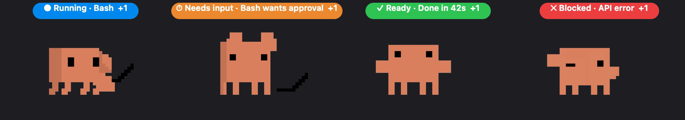

# Octo — a desktop pet for Claude Code

Clawd floats above your windows and tells you what Claude Code is up to.
Like ChatGPT / Codex Pets, for Claude Code. macOS, one Swift file and one mod.



## What it does

- **A status bubble you can read from any app.** Running (and which tool), Needs input (a permission prompt, a question for you, a plan to approve), Ready (finished and not yet looked at), Blocked (API error or refusal). With several sessions the loudest wins — needs input → blocked → ready → running — with a `+N`.
- **Click Clawd** to jump straight into that session in the Claude desktop app.
- **Click the bubble** for the activity list of every live session.
- **Right-click** for Quick chat (send a prompt to Claude without switching windows), Stop a running turn, Tuck away.
- **Drag** it anywhere; it remembers where. Respects Reduce Motion.
- `/pet` in any session wakes it or tucks it away.
- Click it seven times, fast.

## Install

You need:

- macOS 14 or newer, with the Xcode Command Line Tools (`xcode-select --install`). The pet is a single Swift file compiled on your Mac — no binaries to trust.
- The [Claude desktop app](https://claude.ai/download). Clawd's animation is extracted from your own copy, so nothing of Anthropic's is redistributed here.
- Claude Code with mods (2.1.280 or newer, desktop app or CLI).

```bash
claude plugin marketplace add almathkurali/octo-pet
claude plugin install octo-pet@almathkurali
```

Or, without a marketplace:

```bash
git clone https://github.com/almathkurali/octo-pet ~/.claude/skills/octo-pet
```

Start a session. The first time, the mod compiles `Octo.app` (about ten seconds; a toast says so) and launches it. Clawd shows up in the bottom-right corner.

## How it works

```
Claude Code session ──(mod: hooks/register.ts)──▶ ~/.claude/octo-pet/sessions/<id>.json
                                                      state · detail · title · deep-link id · heartbeat
Octo.app (pet/Octo.swift) ◀──── polls every 0.5 s ────┘
Octo.app ──(quick chat, stop)──▶ ~/.claude/octo-pet/cmd/<id>-<t>.json ──▶ mod: $.prompt.submit / $.turn.abort
```

- The mod hooks `turn.start`, `tool.call`, `tool.check`, `turn.complete` and `session.end`, and heartbeats every 5 s; the pet drops a session that goes quiet for 20 s.
- Clicking opens `claude://code/continue?session=<id>` (or `…/needs-input?session=<id>`); the id and title come from the desktop app's own session record under `~/Library/Application Support/Claude/claude-code-sessions`.
- One pet per Mac: every session may launch it, extras exit at once. It stays while the Claude app is open or any session is alive.
- Everything is local files. The only network request is fetching the easter egg's picture, once.

## Troubleshooting

- Nothing shows up: `cat ~/.claude/octo-pet/pet.log`, then `/pet`.
- Rebuild by hand: `sh pet/build.sh`, then `/pet`.
- You tucked it away and want it back: `/pet` (it removes `~/.claude/octo-pet/hidden`).
- Hacking on it: `claude --plugin-dir ~/.claude/skills/octo-pet` watches the folder and reloads the mod on save; `Octo.swift` is recompiled when it is newer than the binary.

## Credits

Clawd is Anthropic's Claude Code mascot. The idea is OpenAI's (ChatGPT and Codex Pets). A Claude Code mod by [@almathkurali](https://github.com/almathkurali). MIT.
